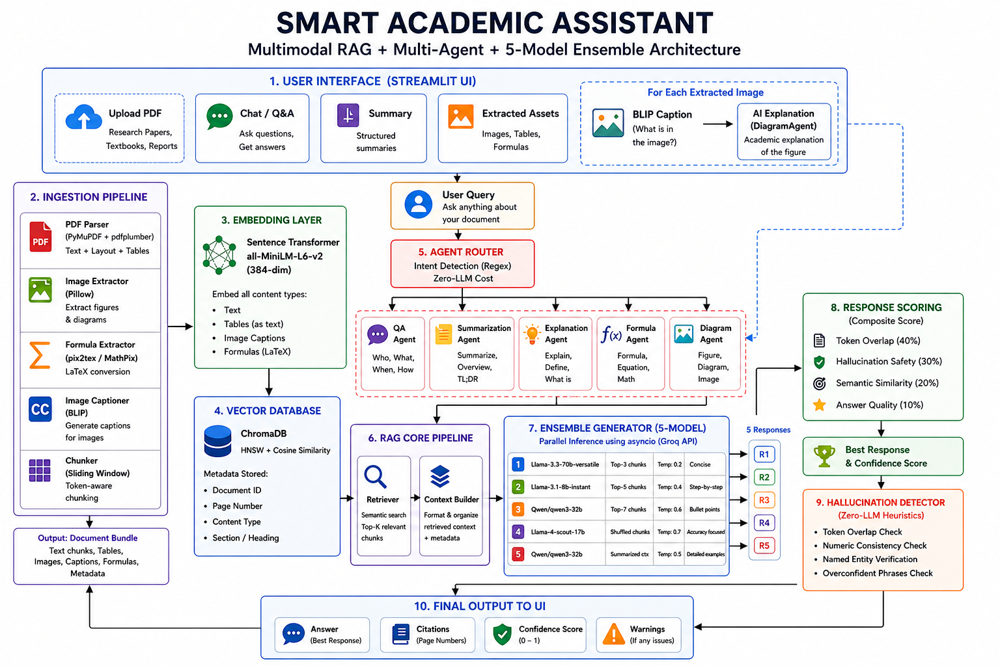
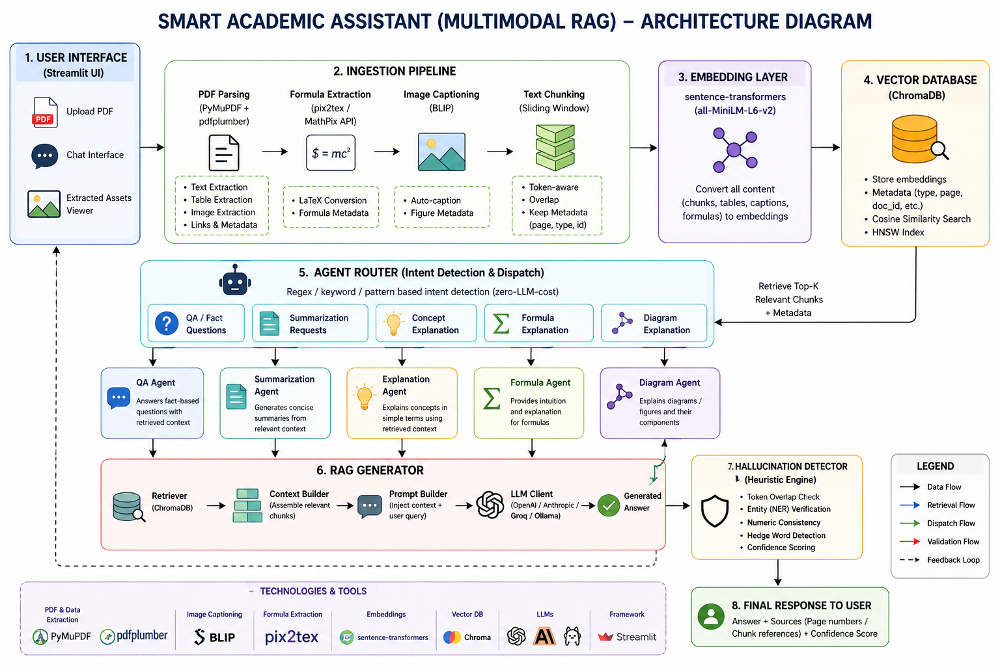

# 🎓 ScholarMind — Smart Academic Assistant (Multimodal RAG + Ensemble LLM)

<p align="center">
  
  
  
  
  
  
</p>

<p align="center">
  
</p>

A production-grade **Multimodal Retrieval-Augmented Generation (RAG)** system specialized for academic documents, powered by a **5-model ensemble** via Groq API.

Upload any research paper or academic PDF and get grounded, hallucination-checked answers, structured summaries, formula breakdowns, and AI-explained diagrams — all backed by semantic vector search and parallel LLM inference.

---

## Features

### Core RAG Pipeline
- **Multimodal Ingestion** — PyMuPDF for layout-aware text extraction, pdfplumber for markdown tables, Pillow for embedded diagrams
- **Token-Aware Chunking** — Sliding-window chunking (512 tokens, 64 overlap) preserving page numbers, section headings, and structural context
- **Sentence-Transformer Embeddings** — `all-MiniLM-L6-v2` (384-dim) with diskcache to skip recomputation on re-ingestion
- **ChromaDB Vector Store** — Persistent HNSW cosine similarity index with metadata filtering by doc, page, and content type

### 5-Model Ensemble Generation
- **Parallel inference** across 5 Groq models using `asyncio`
- **Context variation** per model: top-3, top-5, top-7, shuffled, and summarized chunks
- **Prompt variation** per model: concise, step-by-step, bullet-point, accuracy-focused, detailed
- **Composite scoring**: `0.4×token_overlap + 0.3×hallucination_safety + 0.2×semantic_similarity + 0.1×answer_quality`
- **Inter-model confidence**: mean pairwise cosine similarity across all 5 responses
- **Automatic fallback** to single LLM if ensemble fails

### Multimodal Processing
- **BLIP image captioning** (`Salesforce/blip-image-captioning-base`) — auto-captions every extracted figure
- **AI image explanations** — DiagramAgent generates academic explanations for every image automatically in the Extracted Assets tab
- **Formula OCR** — pix2tex (local) with MathPix API cloud fallback for LaTeX extraction

### Multi-Agent Routing
Intent-based routing (zero-LLM-cost regex) dispatches to:

| Agent | Trigger | Behaviour |
|---|---|---|
| QA Agent | Who / What / When / How | Factual answer with page citations |
| Summarization Agent | Summarize / Overview / TL;DR | Structured: Objective → Methodology → Findings → Conclusions |
| Explanation Agent | Explain / Define / What is | Simple language with analogies |
| Formula Agent | Formula / Equation / Math | Symbol-by-symbol breakdown |
| Diagram Agent | Figure / Diagram / Image | Component identification + academic interpretation |

### Hallucination Detection (Zero-LLM)
Four independent heuristic checks on every generated answer:
- Token overlap ratio between answer and retrieved context
- Numeric consistency (unsupported numbers flagged)
- Named entity verification (unsupported proper nouns flagged)
- Overconfident phrasing detection

---

## System Architecture

<p align="center">
  
</p>

---

## Project Structure

```
smart_academic_assistant/
├── agents/
│   ├── agent_router.py        # Intent detection + lazy agent dispatch
│   ├── base_agent.py          # Abstract base with logging & error handling
│   ├── qa_agent.py
│   ├── summarization_agent.py
│   ├── explanation_agent.py
│   ├── formula_agent.py
│   └── diagram_agent.py
├── config/
│   ├── settings.py            # All config via environment variables
│   └── prompts.py             # Centralized prompt templates
├── data/
│   ├── uploads/               # Saved PDF images (gitignored)
│   ├── chroma_db/             # ChromaDB persistent store (gitignored)
│   └── cache/                 # Embedding diskcache (gitignored)
├── embeddings/
│   ├── embedder.py            # SentenceTransformer wrapper
│   ├── vector_store.py        # ChromaDB upsert + search
│   └── cache.py               # SHA-256 keyed diskcache
├── evaluation/
│   ├── hallucination_detector.py
│   ├── rouge_eval.py
│   ├── qa_eval.py
│   └── logger.py
├── ingestion/
│   ├── pipeline.py            # Full ingestion orchestrator
│   ├── pdf_parser.py          # PyMuPDF + pdfplumber parser
│   └── chunker.py             # Token-aware sliding window chunker
├── multimodal/
│   ├── image_captioner.py     # BLIP captioning
│   ├── image_extractor.py     # Image save/load utilities
│   └── formula_handler.py     # LaTeX OCR (pix2tex / MathPix)
├── rag/
│   ├── ensemble_generator.py  # 5-model async ensemble (NEW)
│   ├── generator.py           # RAG orchestrator (uses ensemble)
│   ├── retriever.py           # Top-k semantic retrieval
│   ├── context_builder.py     # Context formatting + confidence
│   └── llm_client.py          # Multi-provider LLM client
├── utils/
│   ├── file_utils.py
│   └── text_utils.py
├── logs/                      # Runtime logs (gitignored)
├── app.py                     # Streamlit UI
├── requirements.txt
├── .env.example               # Template — copy to .env
├── .gitignore
├── CONTRIBUTING.md
├── solution.md
└── README.md
```

---

## Ensemble Models (Groq)

| # | Model | Temp | Context Strategy | Prompt Style |
|---|---|---|---|---|
| 1 | `llama-3.3-70b-versatile` | 0.2 | Top-3 chunks | Strict & concise |
| 2 | `llama-3.1-8b-instant` | 0.4 | Top-5 chunks | Step-by-step |
| 3 | `qwen/qwen3-32b` | 0.6 | Top-7 chunks | Bullet points |
| 4 | `meta-llama/llama-4-scout-17b-16e-instruct` | 0.7 | Shuffled chunks | Accuracy-focused |
| 5 | `qwen/qwen3-32b` | 0.5 | Summarized context | Detailed examples |

---

## Installation & Setup

### 1. Clone the repository
```bash
git clone https://github.com/BorasteSamir/ScholarMind---Smart-academic-assistant-with-Multimodal-RAG-Ensemble-.git
cd ScholarMind---Smart-academic-assistant-with-Multimodal-RAG-Ensemble-
```

### 2. Create a virtual environment (Python 3.10+)
```bash
python -m venv venv
# Windows
venv\Scripts\activate
# macOS / Linux
source venv/bin/activate
```

### 3. Install dependencies
```bash
pip install -r requirements.txt
```

> PyTorch is required for BLIP image captioning. Install the CPU version if you don't have a GPU:
> ```bash
> pip install torch torchvision --index-url https://download.pytorch.org/whl/cpu
> ```

### 4. Configure environment variables

```bash
# Windows
copy .env.example .env
# macOS / Linux
cp .env.example .env
```

Open `.env` and fill in your keys:

```env
# Active provider
LLM_PROVIDER=groq

# Groq (required for ensemble)
GROQ_API_KEY=gsk_your_groq_key_here
GROQ_MODEL=llama-3.3-70b-versatile

# OpenAI (optional fallback)
OPENAI_API_KEY=sk-your-openai-key-here

# Anthropic (optional)
ANTHROPIC_API_KEY=your-anthropic-key-here
```

Get a free Groq API key at: https://console.groq.com/keys

### 5. Run the application
```bash
streamlit run app.py
```

---

## Usage

### Chat & Q/A Tab
Type any question about the uploaded document. The system auto-detects intent and routes to the correct agent. Each response shows:
- The generated answer
- Sources panel with page citations, per-model scores, and best model name
- Hallucination warning (if triggered)
- Confidence label (High / Medium / Low)

### Document Summary Tab
Click **Generate Summary** for a structured academic summary covering Objective, Methodology, Key Findings, Conclusions, and Key Terms.

### Extracted Assets Tab
- All figures extracted from the PDF are displayed with their BLIP-generated caption
- Each image automatically receives an **AI Explanation** from the DiagramAgent — no button click needed
- All mathematical formulas are shown with rendered LaTeX and an **Explain this** button

### Example prompts
```
# QA
"What dataset was used for training?"
"Who are the authors of this paper?"

# Explanation
"Explain what the attention mechanism is in simple terms."

# Summary
"Give me a summary of the methodology used."

# Formula
"Provide intuition for the formula computing the loss function."

# Diagram
"Explain the figure indicating network architecture layers."
```

---

## Environment Variables Reference

| Variable | Default | Description |
|---|---|---|
| `LLM_PROVIDER` | `groq` | Active provider: `groq` / `openai` / `anthropic` / `local` |
| `GROQ_API_KEY` | — | Groq API key (required for ensemble) |
| `GROQ_MODEL` | `llama-3.3-70b-versatile` | Default Groq model |
| `OPENAI_API_KEY` | — | OpenAI API key (optional fallback) |
| `ANTHROPIC_API_KEY` | — | Anthropic API key (optional) |
| `EMBEDDING_MODEL` | `sentence-transformers/all-MiniLM-L6-v2` | Embedding model |
| `EMBEDDING_DEVICE` | `cpu` | `cpu` or `cuda` |
| `CHUNK_SIZE` | `512` | Tokens per chunk |
| `CHUNK_OVERLAP` | `64` | Overlap tokens between chunks |
| `RETRIEVAL_TOP_K` | `5` | Chunks retrieved per query |
| `LLM_TEMPERATURE` | `0.2` | Generation temperature |
| `LLM_MAX_TOKENS` | `1024` | Max tokens per response |
| `HALLUCINATION_THRESHOLD` | `0.25` | Token overlap threshold |
| `BLIP_MODEL` | `Salesforce/blip-image-captioning-base` | Image captioning model |

---

## Storage

| Location | Contents |
|---|---|
| `data/chroma_db/` | ChromaDB vector embeddings + metadata (persistent) |
| `data/cache/embedding_cache/` | diskcache of raw numpy vectors (skip recompute) |
| `data/uploads/` | Extracted PDF images saved to disk |
| `logs/assistant.log` | Runtime logs |

---

## Production Scalability

To transition from Streamlit to a microservices architecture:
- Wrap `rag/generator.py` inside a **FastAPI** application with background task support
- Replace ChromaDB with a managed vector database (Pinecone, Weaviate, Qdrant)
- Replace diskcache with **Redis** for distributed embedding caching
- Decouple ingestion into async task queues (**Celery** + RabbitMQ/SQS)
- Deploy ensemble calls behind a **rate-limit-aware queue** to respect Groq API limits
